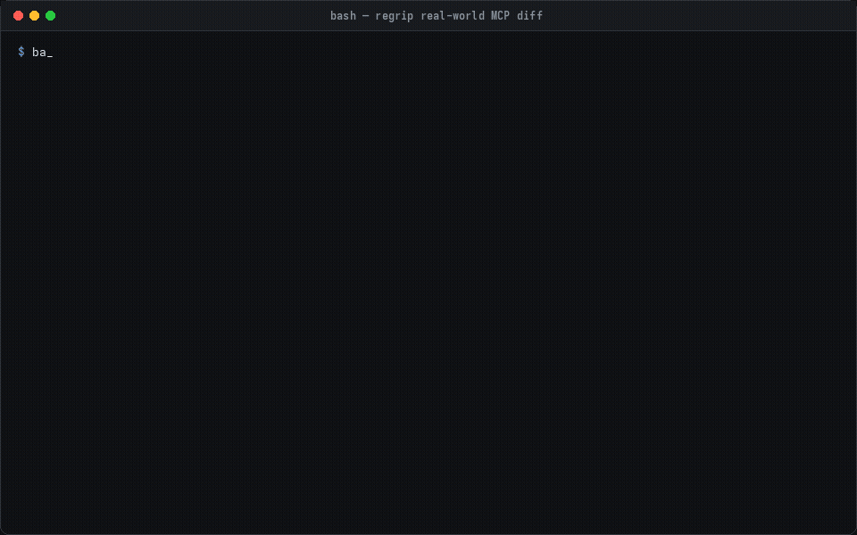
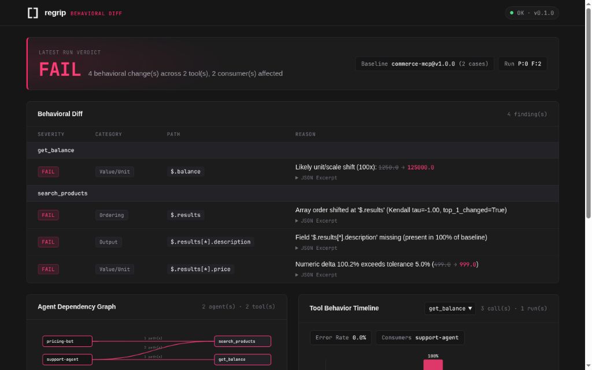
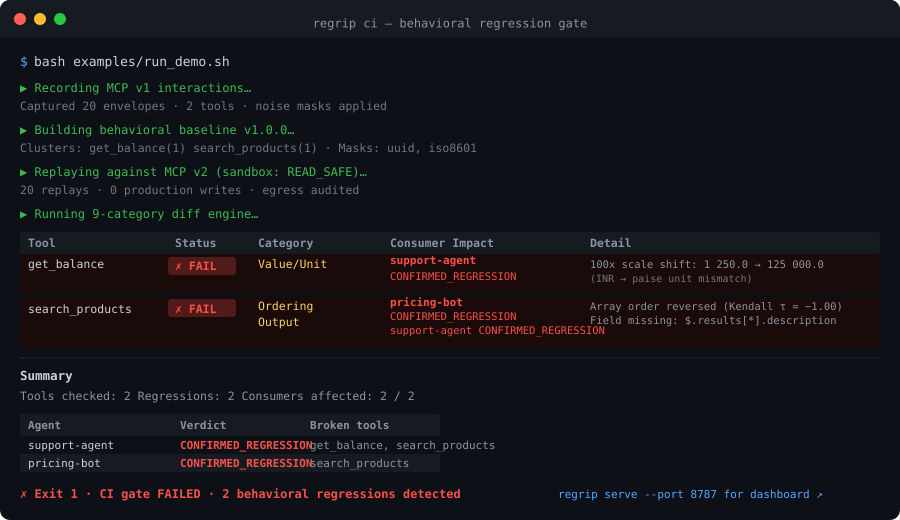

<div align="center">
  
  <br/><br/>

  <strong>Catch breaking MCP tool changes before they break your agents.</strong>
  <br/>
  It records real calls, replays your new server version, and tells you which agent breaks.
  <br/><br/>

  [](https://github.com/Paraspandey-debugs/regrip/actions/workflows/ci.yml)
  [](LICENSE)
  [](pyproject.toml)
  [](crates/regrip-proxy/Cargo.toml)
  [](https://github.com/astral-sh/uv)

  <br/><br/>
  

</div>

---

## The problem

MCP servers change silently. Schema linters only check `tools/list` shapes. LLM evals are stochastic. Neither tells you which of your agents breaks when `get_balance` starts returning paise instead of rupees, or when `search_products` drops the `description` field.

**Regrip** records real tool interactions, builds deterministic behavioral baselines, replays candidate servers safely, and maps every behavioral shift to the AI agents that consume those fields — before you ship.

---

## 30-second demo

```bash
git clone https://github.com/Paraspandey-debugs/regrip && cd regrip
bash examples/run_demo.sh   # records v1 → builds baseline → diffs v2 → opens dashboard
```

**What the demo shows:** `commerce-mcp` v2 ships silent regressions caught before release:



Both agents (`support-agent`, `pricing-bot`) are flagged **CONFIRMED_REGRESSION** with exact field-level evidence — no flakiness, no LLM opinion.

<details>
<summary>CLI / GitHub Action CI gate output</summary>



</details>

---

## Real-world example: `@modelcontextprotocol/server-filesystem`

Running Regrip against two published versions of the official `@modelcontextprotocol/server-filesystem` package (`2025.3.28` → `2025.11.25`):

```bash
bash examples/real_world_filesystem.sh
```

```markdown
## Regrip Compatibility Report — 15 Fail, 0 Warn
Target: npx --offline @modelcontextprotocol/server-filesystem@2025.11.25
vs Baseline: fs-mcp (2025.3.28) · Safe Replay: 2/2 cases executed

| Tool | Status | Category | Consumer Impact | Summary |
| :--- | :--- | :--- | :--- | :--- |
| `read_file` | FAIL | Output + Schema | `coding-assistant`: **UNAFFECTED** | Input parameter `path` became required; `$.hello` missing |
| `list_directory` | FAIL | Schema | `coding-assistant`: **UNAFFECTED** | Input parameter `path` became required |
| `edit_file` | FAIL | Schema | No registered consumers | Input parameters `edits`, `path` became required |
| `move_file` | FAIL | Schema | No registered consumers | Input parameters `destination`, `source` became required |
```

Regrip catches the exact schema tightening and output envelope shift between `2025.3.28` and `2025.11.25`, while confirming `coding-assistant` is `UNAFFECTED` because its recorded calls already supply `path` and read `$.content[0].text`.

---

## Why Regrip?

| | Schema linter | LLM eval | **Regrip** |
|---|:---:|:---:|:---:|
| Detects value/unit shifts (100x scale) | ✗ | ~ | **✓** |
| Detects field removal across call sites | ~ | ~ | **✓** |
| Knows *which agents* break | ✗ | ✗ | **✓** |
| Deterministic (no flakiness) | ✓ | ✗ | **✓** |
| Works with stdio + HTTP + GraphQL + gRPC | ✗ | ✗ | **✓** |
| Zero-config capture via proxy | ✗ | ✗ | **✓** |
| Blocks CI on regressions | ~ | ✗ | **✓** |

---

## Features

- **Zero-config capture** — transparent `stdio` proxy or Streamable HTTP/SSE proxy; drop in with one flag
- **Auto-noise calibration** — UUIDs, ISO-8601 timestamps, and nonces masked automatically; no manual patterns
- **9-category diff engine** — Schema, Output (missing keys + Jaro-Winkler renames), Type, Value/Unit (100x PSI drift), Ordering (Kendall τ), Default, Error, Semantic (JSONPath assertions), Side-Effect
- **Consumer impact graph** — three-source field lineage maps broken tools to downstream agent verdicts (`UNAFFECTED` / `POTENTIALLY_BROKEN` / `CONFIRMED_REGRESSION`)
- **Safety-first replay** — 3-tier `SafetyTier` (`READ_SAFE`, `DRY_RUN_ONLY`, `WRITE_BLOCKED`), never touches production URLs, audits unexpected egress
- **Pre-persistence PII & secret redaction** — `drop`/`mask`/`hmac_token` enforced in both Python and the Rust `regrip-proxy` crate before disk writes
- **Multi-protocol** — MCP (stdio + HTTP), OpenAPI, A2A, GraphQL, gRPC — single unified diff engine
- **Rust `regrip-proxy`** — hot-path capture at line rate via `tokio`/`hyper`/`axum` with optional `--ca-cert` HTTPS termination
- **GitHub Action** — `uses: Paraspandey-debugs/regrip@main` publishes a job summary and maintains a sticky `<!-- regrip-report -->` PR comment with Check Run status
- **Local dashboard** — `regrip serve --port 8787` launches a dependency graph, timeline, and baseline explorer

---

## Installation

### Recommended (uv)

```bash
uv tool install regrip
```

### pip

```bash
pip install regrip
```

### One-liner

```bash
bash <(curl -fsSL https://raw.githubusercontent.com/Paraspandey-debugs/regrip/main/install.sh)
```

### From source

```bash
git clone https://github.com/Paraspandey-debugs/regrip
cd regrip
make dev        # uv sync --dev
make demo       # run the v1→v2 demo without opening a browser
```

---

## Usage

```bash
# 1. Initialize workspace
regrip init --project my-agents

# 2. Record live MCP interactions (stdio or HTTP proxy)
regrip record --server finance-mcp --agent billing-bot --stdio -- python -m finance_mcp
regrip record --server catalog-mcp --listen http://127.0.0.1:9100 --upstream http://127.0.0.1:8000/mcp

# 3. Build an immutable behavioral baseline
regrip baseline build --server finance-mcp --tag v1.0.0 --output .regrip/baselines/v1.json

# 4. Run the CI gate against a candidate (replay + diff + impact)
regrip ci \
  --baseline .regrip/baselines/v1.json \
  --target "python -m finance_mcp_v2" \
  --format markdown,json,junit \
  --out-dir .regrip/reports

# 5. Inspect drift history or browse the dashboard
regrip history --tool get_balance
regrip serve --port 8787
```

### Exit codes

| Code | Meaning |
|:---:|---|
| `0` | All tools pass — no behavioral regressions |
| `1` | Regressions detected — CI gate FAILED |
| `2` | Replay errors (server unreachable, timeout) |
| `3` | Configuration or baseline error |

---

## Python SDK

```python
from regrip import RegripRecorder, expect_fields

recorder = RegripRecorder(
    agent_id="support-agent",
    store_uri="sqlite:///.regrip/regrip.db",
    fail_open=True,  # never block your agent on regrip errors
)

async with recorder.wrap_mcp_session(mcp_session, server_name="orders-mcp") as session:
    with expect_fields(
        tool="search_products",
        jsonpaths=["$.results[*].id", "$.results[*].description"],
        order_sensitive=True,
    ):
        result = await session.call_tool("search_products", {"query": "laptop"})

# Optional: track which keys your agent actually reads
tracked = recorder.track_consumption(tool="get_user", payload=result.structuredContent)
user_id = tracked["id"]  # recorded as a consumed field → drives CONFIRMED_REGRESSION
```

---

## GitHub Action

```yaml
# .github/workflows/regrip.yml
- uses: Paraspandey-debugs/regrip@main
  with:
    baseline: .regrip/baselines/v1.json
    target: "python -m finance_mcp_v2"
    sandbox: auto          # auto-detects docker/podman; falls back to subprocess
    format: markdown,json
```

The action publishes a job summary, posts a sticky `<!-- regrip-report -->` PR comment, and fails the check if `regrip ci` exits non-zero.

---

## CLI reference

| Command | Purpose |
|:---|:---|
| `regrip init` | Initialize `regrip.yaml` and `.regrip/` workspace |
| `regrip record` | Capture MCP stdio or Streamable HTTP interactions |
| `regrip baseline build / inspect / export / import` | Manage baseline bundles (`.regrip-baseline.tar.zst`) |
| `regrip replay` | Safely replay a baseline against a candidate target |
| `regrip diff` | Run the 9-category deterministic diff engine |
| `regrip impact` | Compute per-agent verdict matrix |
| `regrip ci` | Full gate: replay + diff + impact (exit 0/1/2/3) |
| `regrip export` | Export a report in JSON, Markdown, or JUnit XML |
| `regrip history` | Query chronological drift per tool |
| `regrip serve` | Launch REST API + dashboard at `http://127.0.0.1:8787` |

---

## Architecture

```
  Your agents
      │  MCP calls (stdio / HTTP)
      ▼
 ┌─────────────────────────────────────────────┐
 │  regrip-proxy  (Rust · tokio · hyper)        │  ← zero-overhead capture
 │  PII/secret redaction before disk writes     │
 └────────────────┬────────────────────────────┘
                  │  InteractionEnvelope (SQLite WAL + .jsonl.zst)
                  ▼
 ┌─────────────────────────────────────────────┐
 │  core/  (pure Python, no I/O)               │
 │  ├─ baseline_model   (noise calibration)    │
 │  ├─ diff_detectors   (9 categories)         │
 │  ├─ consumer_graph   (field lineage)        │
 │  └─ replay_policy    (SafetyTier)           │
 └────────────────┬────────────────────────────┘
                  │
         adapters/  (MCPDriver, GraphQLDriver, GRPCDriver,
                     SQLiteStore, PostgreSQLStore, S3Store,
                     DockerSandbox, GitHubCheckRunReporter)
                  │
              CLI / GitHub Action / Python SDK
```

See [docs/architecture.md](docs/architecture.md) for full module boundaries.

---

## Contributing

```bash
make dev        # install all dependencies
make check      # ruff + mypy + pytest (CI-equivalent)
make demo       # run the demo regression scenario
make rust-test  # cargo test --workspace
```

See [CONTRIBUTING.md](CONTRIBUTING.md) for the full guide, including the strict anti-monolith rules (< 300 lines per file, one concern per module) enforced by CI.

---

## License

[MIT](LICENSE) © Paras Pandey
