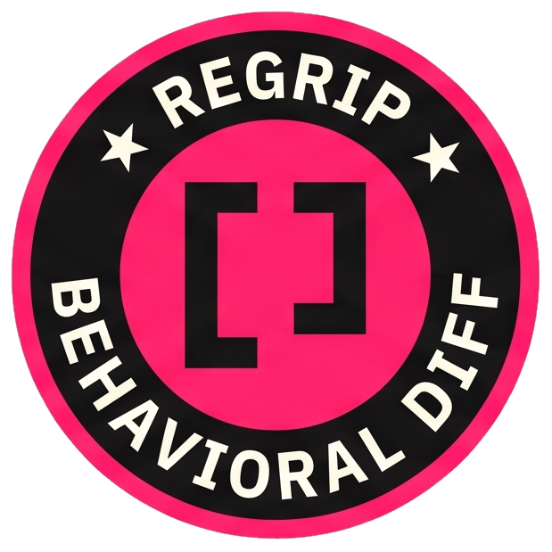

<div align="center">
  

# Regrip

**Know what breaks before your agents do. Test the behavior, not just the schema.**

[](https://github.com/Paraspandey-debugs/regrip/actions/workflows/ci.yml)
[](LICENSE)
[](pyproject.toml)
[](crates/regrip-proxy/Cargo.toml)

Behavioral regression testing and consumer-compatibility platform for Model Context Protocol (MCP) servers and AI agent tool integrations.

</div>

---

## Why Regrip?

MCP schema linters only check `tools/list` shapes, and LLM evals test prompt trajectories stochastically. **Regrip** records real tool interactions, builds deterministic behavioral baselines with automatic volatile-noise masking, replays candidate servers inside policy-gated sandboxes, and maps every behavioral shift directly to the AI agents that consume those fields.

## Key Capabilities

- **Capture Proxies (`stdio` & `Streamable HTTP`) + Python SDK:** Transparently capture MCP `tools/call` interactions into canonical `InteractionEnvelope` records (`SQLite` WAL + `.jsonl.zst` blobs) with fail-open recording and W3C `traceparent` attribution.
- **Pre-Persistence PII & Secret Redaction:** Two-stage redaction (`drop`, `mask`, `hmac_token` + JWT/Bearer/AWS/email/SSN/card detectors) enforced in both Python and the Rust `regrip-proxy` crate prior to disk/DB writes.
- **Behavioral Baseline & Auto-Noise Calibration:** Clusters inputs by `(tool_name, arg_keys, value_shape)` and automatically masks volatile UUIDs and timestamps, with portable `.regrip-baseline.tar.zst` export/import.
- **9-Category Behavioral Diff Engine:** Deterministic detection of **Schema**, **Output** (missing keys + Jaro-Winkler key renames), **Type**, **Value/Unit** (10x/100x/1000x scaling & PSI drift), **Default**, **Ordering** (Kendall's tau & Top-K), **Error**, **Semantic** (AST-safe JSONPath assertions & text similarity), and **Side-Effect** regressions.
- **Zero-Trust Safe Replay & Hybrid Sandbox:** Treats MCP `ToolAnnotations` strictly as untrusted hints, blocks production target URLs, enforces `READ_SAFE` / `DRY_RUN_ONLY` / `WRITE_BLOCKED` tiers, and audits unexpected filesystem or state mutations.
- **Consumer-Aware Impact & CI Gates:** Three-source field lineage (`regrip.yaml`, SDK `expect_fields`/`track_consumption`, session correlation), per-agent verdicts (`UNAFFECTED`, `POTENTIALLY_BROKEN`, `CONFIRMED_REGRESSION`), JSON/Markdown/JUnit XML exporters, `regrip history`, OTel GenAI spans, and local `regrip serve` dashboard.

---

## Quickstart

```bash
# 1. Initialize regrip.yaml and .regrip/ workspace
regrip init --project my-agents

# 2. Record MCP stdio or Streamable HTTP interactions
regrip record --server finance-mcp --agent billing-bot --stdio -- python -m finance_mcp
regrip record --server catalog-mcp --listen http://127.0.0.1:9100 --upstream http://127.0.0.1:8000/mcp

# 3. Build an immutable behavioral baseline (and optionally export a .tar.zst bundle)
regrip baseline build --server finance-mcp --tag v1.0.0 --output .regrip/baselines/v1.json
regrip baseline export --server finance-mcp --tag v1.0.0 --output .regrip/v1.regrip-baseline.tar.zst

# 4. Run full CI compatibility gate (replay + diff + consumer impact + reports)
regrip ci \
  --baseline .regrip/baselines/v1.json \
  --target "python -m finance_mcp_v2" \
  --format markdown,json,junit \
  --out-dir .regrip/reports

# 5. Inspect historical drift or launch the local web dashboard
regrip history --tool get_balance
regrip serve --port 8787

# Or run the zero-dependency interactive v1 -> v2 demo + dashboard in one command:
bash examples/run_demo.sh
```

## CLI Commands

| Command | Purpose |
| :--- | :--- |
| `regrip init` | Initialize `regrip.yaml` and `.regrip/` local workspace |
| `regrip record` | Proxy an MCP `stdio` or Streamable HTTP server and persist redacted envelopes |
| `regrip baseline build / inspect / export / import` | Cluster interactions, inspect profiles/masks, and share `.tar.zst` bundles |
| `regrip replay` | Safely replay a baseline against a candidate target under 3-tier safety policy |
| `regrip diff` | Run the 9-category deterministic diff engine against a run or baseline |
| `regrip impact` | Compute per-agent `UNAFFECTED` / `POTENTIALLY_BROKEN` / `CONFIRMED_REGRESSION` matrix |
| `regrip ci` | Execute replay + diff + impact gate with deterministic exit codes (`0`/`1`/`2`/`3`) |
| `regrip export` | Export a stored replay report in JSON, Markdown, or JUnit XML format |
| `regrip history` | Query chronological failure rates, git SHAs, top args, and consumers per tool |
| `regrip serve` | Start local REST API (`/api/v1/*`) and Web Dashboard on `http://127.0.0.1:8787` |

---

## GitHub Action

Use the repository's composite [action.yml](action.yml) in pull request workflows to run `regrip ci`, publish job summaries, and maintain a sticky `<!-- regrip-report -->` PR comment:

```yaml
- uses: Paraspandey-debugs/regrip@main
  with:
    baseline: .regrip/baselines/v1.json
    target: "python -m finance_mcp_v2"
    sandbox: auto
```

---

## Python SDK

```python
from regrip import RegripRecorder, expect_fields

recorder = RegripRecorder(
    agent_id="support-agent",
    store_uri="sqlite:///.regrip/regrip.db",
    fail_open=True,
)

async with recorder.wrap_mcp_session(mcp_session, server_name="orders-mcp") as session:
    with expect_fields(
        tool="search_products",
        jsonpaths=["$.results[*].id", "$.results[*].description"],
        order_sensitive=True,
    ):
        result = await session.call_tool("search_products", {"query": "laptop"})

# Optional dynamic key access tracking
tracked = recorder.track_consumption(tool="get_user", payload=result.structuredContent)
user_id = tracked["id"]
```

---

## Architecture & Contributing

See [docs/architecture.md](docs/architecture.md) for module boundaries (`types`, pure `core`, `adapters`, `cli`, and `crates/regrip-proxy`) and [CONTRIBUTING.md](CONTRIBUTING.md) for contribution guidelines.

```bash
# Python checks & tests
uv sync --dev
uv run ruff check . && uv run ruff format --check .
uv run mypy src
uv run pytest -v --tb=short

# Rust proxy checks & tests
cargo test --workspace
cargo clippy --workspace --all-targets -- -D warnings && cargo fmt --check
```

## License

[MIT](LICENSE)
